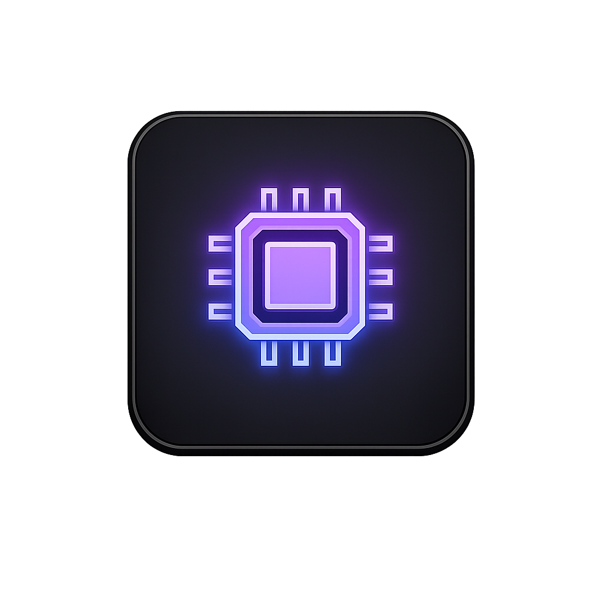

<div align="center">



# Consolio

**Темний швидкий провідник для Windows з вкладками, вбудованими переглядачами та редактором коду.**


</div>

---

## Можливості

- **Вкладки та швидкий доступ**: кілька тек одночасно, сесія відновлюється після перезапуску
- **Три вигляди**: таблиця, список і плитки
- **Справжні іконки** програм і ярликів (`.exe`, `.lnk`); файли, яких провідник не розуміє, відкриваються системою
- **Вбудовані переглядачі**: галерея зображень, відео- та аудіоплеєр
- **Редактор коду** на CodeMirror з підсвічуванням десятків мов
- **Миттєвий пошук** по всьому комп'ютеру завдяки фоновому індексу
- **Телефони та змінні носії**: MTP-пристрої, USB-накопичувачі
- **Файлові операції**: копіювання, переміщення, ZIP, масове перейменування, смітник і скасування дій

Усі комбінації клавіш зібрані в застосунку: кнопка ⌨ унизу ліворуч, на панелі вкладок.

## Пошук

| Запит | Що знайде |
|---|---|
| `звіт 2026` | назви, де є обидва слова |
| `"точна фраза"` | саме цю послідовність символів |
| `*.py`, `звіт??.docx` | за маскою |
| `ext:jpg,png` | лише з такими розширеннями |
| `type:folder` / `type:file` | тільки теки / тільки файли |
| `in:projects` | шлях містить цей фрагмент |

## Запуск із вихідників

```bash
pip install pywebview pillow
python main.py
```

Потрібен [WebView2 Runtime](https://developer.microsoft.com/microsoft-edge/webview2/) (у Windows 10/11 зазвичай уже є).

## Збірка інсталятора

1. Встановіть [Inno Setup 6](https://jrsoftware.org/isdl.php).
2. Розпакуйте архів **vendor.zip** і покладіть теку vendor в головну теку проекту, поруч з **main.py**
3. Запустіть `build.bat`.

На виході будуть `dist\Consolio\Consolio.exe` та `installer_output\Consolio-Setup-<версія>.exe`.

Налаштування та індекс пошуку встановленої версії зберігаються в `%APPDATA%\Consolio`.
